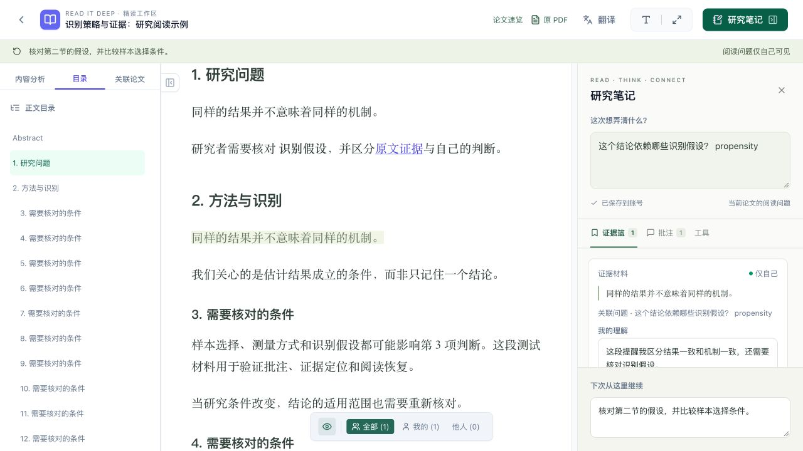
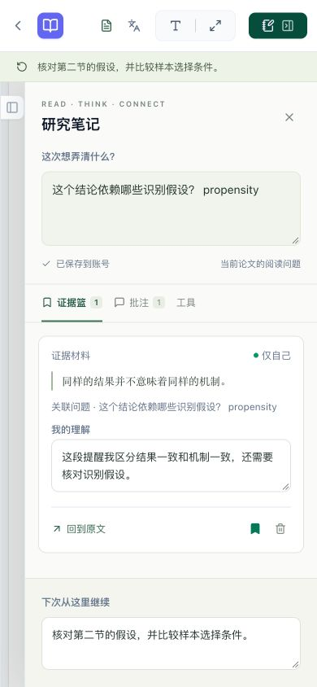

# 研究阅读工作区：首批实现与验收

2026-10-27，Asia/Shanghai。承接 `2026-10-27-research-reading-refactor.md`。本批为应用实现，**未生产部署、未创建 release tag**。

## 已交付范围

- 默认直接进入正文；论文速览改为可选入口，保留 Zen、翻译和现有分析工具。
- 左侧目录由 Markdown 直接生成，不等待 AI 分析。中间保留原文阅读；右侧围绕当前阅读问题、证据篮、批注和下次继续事项组织。
- 选区优先提供批注、收进证据篮、高亮；AI 辅助与方法/资产提炼为展开工具，提示候选解释需要核对。
- 工作台旧笔记与 annotation 在同一个批注页中可见，保留旧对象和存储。旧笔记位置标明待核对，不把它们追认为已验证证据。
- 阅读问题、next action、字体、原译文模式、语义位置和位置回退比例保存到本人账号，采用 version CAS。失败保留草稿，冲突不自动覆盖。
- 每条批注的保存共用串行队列，失焦与导航 flush 均保存最新草稿；浏览器 Back 与站内导航都先保存，失败留页。刷新/关页有未保存提示。
- 内容快照按原始 Markdown hash 与 representation 建立 immutable revision。选区保存 UTF-16 文本范围、完整摘录和前后文；定位核对版本及前后文，不对重复文本取首项。
- 新版正文或译文不能套用旧 anchor；没有唯一原文匹配时提示核对。既有内容快照和工作区加入纸张删除/账号删除路径。
- 原 PDF 经鉴权接口打开核验。没有 PDF 页映射时不提供虚构跳页。
- 内容可读性独立于后续 AI 加工状态，论文库和 Reader 可以打开已生成的正文。
- 删除虚构作者/机构 fallback；手机面板为抽屉，避免同时遮挡正文；全局 `P` 快捷键忽略编辑框、IME 和组合键。
- 登录/退出清理 Query cache，新阅读请求与旧笔记 query 按用户区分。

## 数据与部署衔接

Alembic `0004` 新增 `reading_revisions`、`reading_workspaces`，并给既有 annotation 增加 `anchor/is_evidence/research_question`。现有批注保留，新增列兼容旧数据。迁移由现有启动升级流程执行；本批没有执行线上 DDL。

`research_question` 是本地阅读焦点的文字快照；`is_evidence` 是材料收集标记。两者都不表示正式主站问题 ID 或事实验证。原文快照也不构成重新解析质量验收。

本批继续复用 standalone/linked 身份实现，未启用 PaperDaily 资源 scope、阅读记忆发布、受信 runner 或计费流量。关联模式的新本地端点沿用当前账号/会话实时检查。

## 验证记录

### 自动验证

- 后端 SQLite 全套：**125 passed, 1 skipped**（54.93s，739 条既有/依赖弃用提示；跳过 PostgreSQL 专项）；本地最终重跑执行 `env -u RID_TEST_DATABASE_URL -u DATABASE_URL uv run pytest -q --disable-warnings`。
- 新增后端验证：工作区持久化、另一窗口冲突、跨用户拒绝、不可变内容快照、跨论文 anchor 拒绝、原 PDF 鉴权、AI 加工期间可读、错误 checkpoint 不落库、删除清理。
- Alembic 验证包含 fresh/legacy schema 对照及从 `0003` 升级保留历史批注。
- 前端 `npm test`：**12 passed**，包括重复句第二处、跨格式/中英/emoji、版本隔离、前后文校验、KaTeX 隐藏节点、保存冲突/断网、blur 与导航的在途合并、A→B→C 批注保存顺序、浏览器 Back 的成功/409/500。
- 前端 `npm run build`：通过。保留既有大 bundle 和 Browserslist 数据陈旧提示，不提高 warning 阈值。
- `ruff check --select E9,F63,F7,F82` 与 `git diff --check`：通过。

### 本地真实浏览器

以独立临时 SQLite、合成用户和合成论文验证；仅绑定 loopback，关闭 inference worker。

1. 从论文库直接进正文；目录无 AI 分析也可用。
2. 输入中文问题与英文 `propensity`，不误触 Zen；问题与 next action 保存。
3. 在第二节选中与第一节完全相同的句子，收进证据篮。
4. 填写理解后切换批注/证据 tab，文字保留；刷新后问题、材料、理解及阅读位置均可恢复。
5. 从第一节点击“回到原文”，实际回到第二节对应句子。
6. 在 390×844 视口核对正文、研究笔记抽屉和底部 next action；工具栏不纵向挤压，高亮筛选条不遮挡抽屉输入。

截图为本地合成材料，不代表生产站点：

## Astra 复审修复

已处理保存失败仍导航、输入 `P` 误触、面板卸载丢 note draft、workspace 保存并发、团队可见性误标、anchor 快路径缺上下文、图片/重排下恢复位置、浏览器 Back 绕过保存，以及 annotation blur/导航写入竞态。Astra 负责只读源码评审；测试和浏览器验证由主 agent 执行。

## 后续边界

本批没有实现 ContentBlock 独立表与跨 revision 迁移、历史 revision 的独立核验 UI、跨论文证据矩阵、正式 PaperDaily question 映射与 reading session 发布、资源消费者或受信 jobs。图片冷加载时的恢复做短时布局跟踪并在用户主动操作后停止；它不等于完整 PDF/Markdown 同步阅读。
